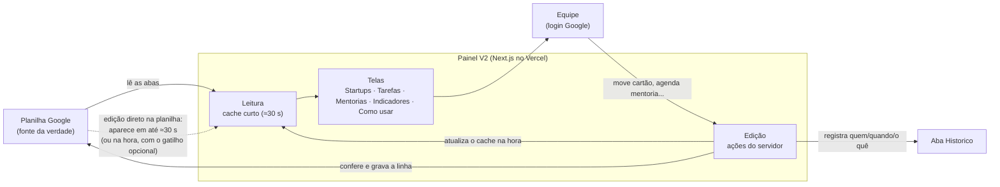

# Plano da V2 — Painel da equipe da Incubadora

> **Status:** planejamento para o futuro. Nada aqui está implementado.
> A V1 (este repositório, HTML/CSS/JS puro) continua sendo o painel em uso e fica
> congelada no branch **`v1-html`** (commit `fb4c0a6`; release `v1.0.0`) — qualquer ajuste pequeno segue sendo feito nela até a
> V2 estar pronta para substituí-la.
>
> **Escopo:** só o painel da equipe (`equipe.html`: Startups, Tarefas, Mentorias,
> Indicadores e Como usar). A apresentação com as 12 telas (`index.html`: agenda,
> relacionamento/CRM, parcerias etc.) é um plano à parte e não entra aqui.

## 1. O que a V2 precisa fazer

| # | Requisito | Por quê |
|---|---|---|
| 1 | **Editar pelo painel e pela planilha, nos dois sentidos.** Mudou na planilha → aparece no painel. Mudou no painel → grava na planilha. | A equipe já trabalha na planilha; o painel vira um jeito mais fácil e visual de fazer as mesmas coisas. |
| 2 | **A planilha continua sendo o banco de dados.** Sem Supabase, sem banco separado para os dados. | Uso interno e pequeno; a planilha já é a fonte da verdade, tem histórico de versões do Google e todos sabem abrir. |
| 3 | **Login** — só a equipe entra. | Hoje o site é público; com edição pelo painel, login passa a ser obrigatório. |
| 4 | **Mais visual e reaproveitável** — gráficos, dashboards, quadro de tarefas, planejamento. | Componentes prontos em vez de HTML montado como texto; telas novas saem mais rápido. |
| 5 | **Manter (e ampliar) os tutoriais** — a tela "Como usar" é parte do produto. | A equipe não é técnica; o sistema precisa ensinar. |
| 6 | **Funcionar bem no celular.** | Já é assim na V1; não pode regredir. |

## 2. Stack recomendada

| Camada | Escolha | O que resolve |
|---|---|---|
| Framework | **Next.js** (React, App Router) + **TypeScript** | Telas em componentes reaproveitáveis; servidor e tela no mesmo projeto; tipos pegam erro antes de chegar à equipe. |
| Visual | **Tailwind CSS** + **shadcn/ui** | Botões, formulários, diálogos, abas e tabelas prontos e acessíveis; mesma identidade visual da V1 (cores do Parque viram o tema). |
| Gráficos | **ECharts** (o mesmo da V1, via `echarts-for-react`) | Os gráficos atuais migram quase iguais; nada a reaprender. |
| Quadro de tarefas | **dnd-kit** | Arrastar cartões entre A fazer / Fazendo / Pendente / Feito (e isso grava na planilha). |
| Dados | **Google Sheets API** (conta de serviço, agora com permissão de **Editor**) | Leitura e escrita na própria planilha. |
| Validação | **Zod** | As regras que hoje viram "avisos" (status válido, data, startup existente) passam a valer também para o que se digita no painel. |
| Login | **Auth.js** com **Google** | Entra com a conta Google; **sem banco**: a lista de quem pode entrar é a aba `Equipe` da planilha (ver §4). |
| Hospedagem | **Vercel** (onde a V1 já está) | Mesmo lugar, mesmo fluxo (push no GitHub → publica). Plano gratuito atende. |
| Testes | **Vitest** (regras de cálculo) + **Playwright** (telas, celular e computador) | Os testes que já rodamos na V1 viram testes automáticos a cada mudança. |

**Custo previsto:** zero ou perto disso (Vercel Hobby, Google Sheets, Auth.js e todas as
bibliotecas são gratuitos).

**Alternativas avaliadas e por que não:**

- *Continuar em HTML puro* — serve para ler, mas edição + login + mais telas ficariam
  frágeis sem tipos, sem componentes e sem servidor de verdade.
- *AppSheet (Google)* — edita a planilha e tem login prontos, mas o visual e as telas são
  limitados; não daria o painel que existe hoje (cartões ligados, tutorial, gráficos).
- *Supabase / banco próprio* — mais robusto, porém contra o requisito 2 e sem
  necessidade para o tamanho da equipe.

## 3. Como funciona a edição nos dois sentidos

Regras que deixam isso seguro:

1. **Cada linha tem um `id` fixo** (TAR-001, STU-05, MEN-0123…). O painel nunca grava
   "na linha 47"; procura o `id` e grava nele — se alguém ordenar ou filtrar a planilha,
   nada sai do lugar. Abas que hoje não têm `id` (Mentorias, Diagnosticos, Fomento,
   Empregos) ganham a coluna, preenchida uma vez por script.
2. **Conflito detectado, nunca sobrescrito.** Antes de gravar, o painel relê a linha; se
   ela mudou desde que a pessoa abriu (alguém editou na planilha), a gravação para e
   aparece "esta tarefa foi alterada por outra pessoa — veja a versão atual".
3. **Nada é apagado pelo painel.** Encerrar = mudar o status (Feito, Cancelada,
   Desligada), como já ensina o "Como usar".
4. **Aba `Historico`** (nova): cada gravação feita pelo painel vira uma linha — data/hora,
   pessoa, aba, id, campo, valor anterior, valor novo. Somado ao histórico de versões do
   próprio Google, dá para desfazer qualquer coisa.
5. **Mesmas validações dos dois lados.** O que a planilha aceita pelas listas suspensas é o
   que o formulário do painel aceita (as regras ficam num único arquivo Zod, usado na
   leitura e na escrita).
6. **Planilha → painel em até ≈30 s.** Opcional: um gatilho do Apps Script (`onEdit`) avisa
   o painel a cada edição e a atualização fica instantânea.
7. **Cota da API do Google** (≈60 leituras/min por conta de serviço) não é problema para
   uma equipe pequena com o cache acima; leituras são feitas em lote (todas as abas numa
   chamada, como já é na V1).

## 4. Login sem banco de dados

- Login com Google (Auth.js). Sessão guardada num cookie assinado (JWT) — **não precisa de
  banco** para isso.
- **Quem pode entrar = aba `Equipe` da planilha**: colunas `email`, `ativo`, `papel`.
  Saiu da equipe → `ativo = Não` e o acesso cai no próximo login.
- Papéis:
  - **admin** — tudo, inclusive cadastrar/desligar startup e editar parâmetros (`Config`);
  - **equipe** — tarefas, mentorias, mudar ciclo, diagnósticos, fomento, empregos;
  - **leitura** — só vê (ex.: gestão, convidados).
- Opcional: aceitar só e-mails do domínio da instituição.
- A chave da conta de serviço continua só no servidor (variável de ambiente do Vercel),
  como hoje.

## 5. O que fica editável pelo painel (em ordem de entrega)

| Ordem | Tela | Ações |
|---|---|---|
| 1 | **Tarefas** | Criar tarefa; arrastar entre colunas; mudar responsável, prazo, prioridade; marcar Feito; colar link do Zoho. |
| 2 | **Mentorias** | Agendar (clicando no dia do calendário); marcar Realizada / Cancelada com um toque; resolver as "a confirmar". |
| 3 | **Startups** | Avançar de ciclo; trocar responsável; registrar diagnóstico (formulário com as 6 notas); graduar/desligar (com confirmação). |
| 4 | **Fomento e Empregos** | Formulários curtos de registro. |
| — | Metodologia, Ciclos, Fases, Listas, Config | Continuam só pela planilha (mudam raramente; só admin). |

## 6. Telas da V2 (paridade + o que melhora)

- **Startups** — os cartões atuais, com ações rápidas no próprio cartão (avançar ciclo,
  agendar mentoria, criar tarefa para a startup) e uma página por startup (resumo, linha do
  tempo de mentorias/tarefas/diagnósticos, link do Zoho).
- **Tarefas** — o quadro atual com arrastar e soltar, "minhas tarefas" automático pela
  pessoa logada, e criação rápida.
- **Mentorias** — o calendário atual com agendamento direto nele; visão semana além de mês.
- **Indicadores & Jornada** — os mesmos gráficos, com filtros reaproveitáveis.
- **Planejamento** (nova, se fizer sentido) — linha do tempo das entregas do plano de
  trabalho e prazos das tarefas.
- **Como usar** — mantida e ampliada: cada formulário do painel tem "?" que abre o trecho
  certo do tutorial; um "primeiro acesso" guiado (tour de 5 passos) para quem entra pela
  primeira vez.

## 7. O que reaproveitar da V1

| Da V1 | Na V2 |
|---|---|
| `api/_lib/montar-incubadora.js` (regras de cálculo, avisos) | Vira TypeScript quase linha a linha — é função pura, sem tela. |
| Testes de invariantes e dados sujos (hoje scripts avulsos) | Testes Vitest. |
| Roteiro de testes Playwright (390 px, 1366 px, cenários planilha/sem planilha/falha) | Testes automáticos no CI. |
| `assets/css/tokens.css` (cores, raios, sombras) | Tema do Tailwind. |
| Conteúdo da tela "Como usar" e do LEIA-ME | Mesmo texto, em componentes. |
| Modelo da planilha (abas e colunas) | Igual — só ganha `id` onde falta, `atualizado_em`/`atualizado_por` e a aba `Historico`. |

## 8. Fases

| Fase | Entrega | Critério de pronto |
|---|---|---|
| **0. Congelar a V1** | Branch `v1-html` no commit `fb4c0a6` (feito) e release `v1.0.0` criada a partir dele no GitHub. V1 segue no ar. | Release visível no GitHub. |
| **1. Fundação** | Repositório novo `painel-incubadora-v2`, Next.js + TS + Tailwind + shadcn, login Google com a aba `Equipe`, leitura da planilha com o cálculo da V1 portado e testado. | Login funciona; os números batem 100% com a V1 sobre a mesma planilha. |
| **2. Paridade (só leitura)** | As 5 telas da V1 refeitas com componentes. | Tudo que a V1 mostra, a V2 mostra igual (comparação lado a lado), no celular e no computador. |
| **3. Edição — Tarefas** | Criar/mover/editar tarefas + aba `Historico` + detecção de conflito. | Editar no painel aparece na planilha e vice-versa; teste de conflito simulado. |
| **4. Edição — Mentorias e Startups** | Agendar/confirmar mentorias, avançar ciclo, diagnósticos. | Idem, por tela. |
| **5. Tutoriais e acabamento** | "?" contextual, tour de primeiro acesso, Planejamento (se aprovado). | Alguém da equipe que nunca usou consegue agendar uma mentoria e criar uma tarefa sozinho. |
| **6. Troca** | V2 vira o endereço da equipe; V1 fica no ar por algumas semanas como reserva. | Duas semanas de uso sem bloqueio. |

## 9. Riscos e cuidados

- **Alguém renomeia uma aba ou cabeçalho** → a V2 mostra o mesmo aviso da V1 e não grava
  nada; cabeçalhos protegidos na planilha (aviso ao editar).
- **Duas pessoas editando a mesma coisa** → detecção de conflito (§3, regra 2).
- **Chave da conta de serviço** → só no Vercel; com permissão de Editor, vazar a chave é
  mais grave que hoje — rotacionar se alguém sair da equipe técnica.
- **Planilha crescendo muito** (milhares de linhas por aba) → ainda é ok para este uso; se
  um dia ficar lento, arquivar anos anteriores numa aba/planilha de histórico.
- **Escopo crescer** → manter fora da V2 o que é do Zoho CRM (detalhe dos registros) e o que
  é da apresentação (`index.html`).

## 10. Decisões em aberto (para quando a V2 começar)

1. Aceitar só e-mails do domínio da instituição ou qualquer Google listado na aba `Equipe`?
2. Quem são os admins?
3. A tela **Planejamento** entra na V2 ou fica para depois?
4. Atualização instantânea (gatilho do Apps Script) ou os ≈30 s bastam?
5. Endereço: um subdomínio próprio da instituição ou o endereço do Vercel?
